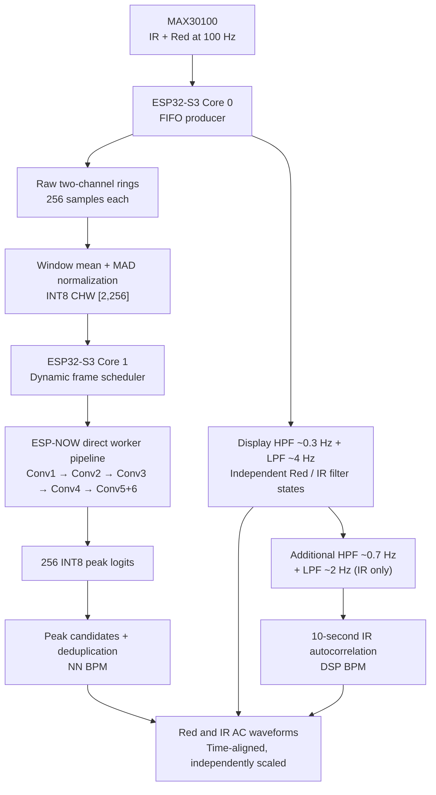
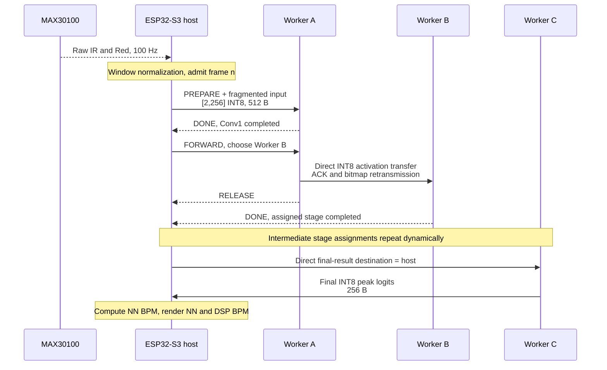

# OVERPULSE — Technical Architecture and Implementation Notes

**Subtitle:** The World's Most Overengineered Heartbeat Counter  
**Status:** Working distributed TinyML research demonstration, nine ESP8266 workers + one ESP32-S3 host  
**Implementation documented:** nine-worker Red/IR firmware with deterministic worker addressing, configurable selective acknowledgments, independent live waveforms, and NN-versus-DSP BPM  

> **Scope and safety:** OVERPULSE is a research and educational demonstrator, **not a clinically validated heart-rate monitor, pulse oximeter, medical device, or diagnostic tool**. The neural peak detector was trained on **synthetic** PPG. The two displayed BPM values can disagree or remain unavailable; neither alone establishes cardiovascular health. A secondary bump in a PPG trace is not automatically a verified dicrotic notch or diastolic wave.

## 1. System at a glance

| Item | Implemented configuration |
|---|---|
| Host | ESP32-S3 CYD, ESP32-1732S019; ST7789 320 × 170 landscape; PSRAM available |
| Workers | **Nine ESP8266**, 160 MHz; IDs W1–W9, each containing the complete PeakNet1D model in Flash |
| Sensor | MAX30100, simultaneous **IR and Red**, I²C address `0x57` |
| Sensor interface | SDA GPIO17; SCL GPIO18; I²C **400 kHz** |
| Sensor operating mode | SpO₂/HR dual-channel (`MODE=0x03`) |
| Sampling rate | **100 samples/s per channel (100 Hz)**; no resampling |
| MAX30100 register configuration | `SPO2_CONFIG=0x47` (100 Hz, 1,600 µs LED pulse, 16-bit), `LED_CONFIG=0x77` (Red ≈24 mA, IR ≈24 mA, default) |
| Optional LED experiment | `PPG_LED_CONFIG=0x8F` (Red ≈27.1 mA, IR ≈50 mA); **not** the default configuration |
| Input window | 256 samples/channel = **2.56 s** |
| Model input | `INT8`, CHW `[2,1,256]` in Noodle2; semantically **`[IR,Red] × 256`** = 512 bytes |
| Model output | `INT8` signed **256 peak logits**, one score for each source-sample position |
| Window stride | **64 samples**, nominally **0.64 s**; **1.5625 windows/s** maximum new-window rate before load-related skips |
| Model | PeakNet1D, **six Conv1D layers**, realized as Noodle2 Conv2D with height=1 |
| Distributed execution | **Five stages**, the last stage executes Conv5 **and** Conv6 |
| Wireless transport | ESP-NOW on channel **6**; maximum packet 250 B, protocol header 20 B, activation fragment up to 230 B |
| Transport ACK interval | `NOODLE_ACK_INTERVAL=18`; one 32-bit bitmap ACK per tensor in the no-loss case, selective retransmission, **1 ms** fragment pacing |
| Software tensor CRC32 | **OFF** (`NOODLE_TRANSPORT_CRC=0`); Wi-Fi frame-level FCS remains active |
| Scheduling | Host chooses an available worker dynamically; direct worker-to-worker activation handoffs |
| Occupancy | `NOODLE_MAX_OCCUPANCY=5`, `NOODLE_HOST_OCCUPANCY=3`, `NOODLE_RESERVED_WORKERS=1` |
| Measured observed latency | Approximately **700 ms** end-to-end distributed inference observed in the nine-worker hardware setup; not a controlled statistical benchmark |
| Heart-rate estimates | Independent **NN BPM** from distributed PeakNet1D logits and **DSP BPM** from filtered-IR autocorrelation |

### Data-flow overview



**The central preprocessing fact:** **The neural network does not receive the filtered display waveform.** Both filter paths are separate from the NN input. The NN uses the **original raw sensor samples**, normalized and quantized *per 256-sample window* using the same preprocessing as during QAT training.

---

## 2. Sensor acquisition and signal processing: exact filter paths

### 2.1 Raw sensor acquisition

The host's `src/Max30100Raw.cpp` reads up to eight FIFO samples per call. Each FIFO sample is four bytes, in the order **IR MSB, IR LSB, Red MSB, Red LSB**. `sensor_task()` (Core 0) polls every approximately 10 ms, updates the raw rings, and separately advances two causal display filter instances.

```cpp
// Sensor setup performed by the host MAX30100 driver:
write_reg(REG_SPO2, 0x47);             // 100 Hz, 1600 us, 16-bit
write_reg(REG_LED, PPG_LED_CONFIG);    // default 0x77
write_reg(REG_MODE, 0x03);            // IR + Red in SpO2 mode
```

A sample is treated as having optical contact when **IR ≥ 1000 and Red ≥ 1000 raw counts**. FIFO overflow, I²C read failure, or lost contact invalidates continuous-signal history; stale NN peaks from the previous signal epoch are discarded. This is a simple experimental contact gate, not a validated optical quality index.

### 2.2 First band-pass approximation: waveform display, both channels

Implementation: `DisplayFilter` in `src/main_host.cpp`, one independent state for IR and one for Red. It consists of a **first-order high-pass** followed by a **first-order low-pass**; it is not a Butterworth or zero-phase filter.

**High-pass, approximately 0.3 Hz at 100 Hz sampling:**

```cpp
hp = 0.981325f * (hp + x - prev_x);
prev_x = x;
```

**Low-pass, approximately 4 Hz at 100 Hz sampling:**

```cpp
lp += 0.222232f * (hp - lp);
```

The filtered result is rounded and clipped to `int16_t` for drawing. Filtering state persists between windows and is updated once per acquired sample. Each color trace is **independently vertically auto-scaled** but shares the same horizontal sample indices, so plot heights should **not** be interpreted as comparable amplitudes.

**Consumers:** the Red and IR TFT plots; the filtered IR is also the *input to the next DSP filter*. **Not fed to PeakNet1D.** The 0.3–4 Hz display filter may alter narrow waveform details, including a possible notch/secondary hump.

### 2.3 Second band-pass approximation: additional DSP BPM filter, IR only

Implementation: `BpmEstimator::push()` in `src/BpmEstimator.h`. It takes the **already display-filtered IR**, then applies another causal HPF and LPF:

**Additional high-pass, approximately 0.7 Hz:**

```cpp
hp_ = 0.958f * (hp_ + x - previous_);
previous_ = x;
```

**Additional low-pass, approximately 2 Hz:**

```cpp
lp_ += 0.112f * (hp_ - lp_);
```

The effective DSP preprocessing is **a cascade of both filtering stages**, not just a single 0.7–2 Hz filter acting on raw IR. The second-stage output is stored in a **1,000-sample / 10-second** ring.

### 2.4 Summary: which path sees which signal?

| Consumer | Signal input | Filter / conditioning |
|---|---|---|
| PeakNet1D (NN) | Raw IR + raw Red, 256 samples/channel | **No temporal HPF/LPF**; per-channel **window mean removal + mean absolute deviation normalization + INT8 quantization** |
| IR waveform on TFT | Raw IR | Display HPF ~0.3 Hz → LPF ~4 Hz |
| Red waveform on TFT | Raw Red | Separate but identical display HPF ~0.3 Hz → LPF ~4 Hz |
| DSP BPM | Raw IR | Display HPF ~0.3 Hz → LPF ~4 Hz → additional HPF ~0.7 Hz → LPF ~2 Hz → autocorrelation |
| NN BPM | Returned PeakNet1D logits | Logit threshold, temporal peak selection, overlap deduplication, interval quality checks; **no extra raw-signal DSP filter** |

### 2.5 Exact neural-network input normalization

From `src/PPGPreprocess.h`, processed **independently for each channel** in each window:

1. Read 256 raw unsigned 16-bit sensor values.
2. Compute the **integer mean**, `mean = floor(sum(x)/256)`.
3. Compute the **integer mean absolute deviation**, `MAD = floor(sum(abs(x-mean))/256)`.
4. Use denominator `max(MAD, 16)` so very small AC amplitudes do not cause unbounded gain.
5. Quantize `(x - mean) × 32 / denominator` with symmetric **round-half-away-from-zero** and saturate to `[-128, 127]`.
6. Lay out the bytes as **IR `[0..255]` followed by Red `[256..511]`** (CHW). Input zero-point = 0, and the training/export input scale = **1/32 = 0.03125**.

A minimal mathematical description is

\[
q_c[t] = \operatorname{sat}_{[-128,127]}\!\left(\operatorname{round}_{\text{away from 0}}\!\left(\frac{32(x_c[t]-\mu_c)}{\max(\mathrm{MAD}_c,16)}\right)\right).
\]

This is **amplitude normalization**, not temporal upsampling or low-pass filtering. At 100 Hz, 256 samples always represent 2.56 seconds; merely raising the sensor rate without retraining would change the model's time scale.

---

## 3. PeakNet1D neural-network architecture

The PyTorch trainer is `train_peaknet_ppg_qat.py`; the exported model metadata is `model_export/model_manifest.json`. It is a **samplewise systolic-peak candidate detector**, not a single-class heartbeat classifier and not a diastolic-peak classifier.

| Conv layer | Input channels → output channels | Kernel along time | Output CHW shape | Activation | Weight + bias parameters |
|---|---|---:|---|---|---:|
| Conv1 | 2 → 8 | 9 | `[8,1,256]` | ReLU | 152 |
| Conv2 | 8 → 16 | 7 | `[16,1,256]` | ReLU | 912 |
| Conv3 | 16 → 16 | 7 | `[16,1,256]` | ReLU | 1,808 |
| Conv4 | 16 → 16 | 7 | `[16,1,256]` | ReLU | 1,808 |
| Conv5 | 16 → 16 | 1 | `[16,1,256]` | ReLU | 272 |
| Conv6 | 16 → 1 | 1 | `[1,1,256]` | **LOGITS** (no sigmoid in firmware) | 17 |
| **Total** | | | | | **4,969** |

All convolutions use stride 1 with same padding; spatial height remains 1. A Conv1D is expressed to Noodle2 as **Conv2D with kernel `(1,K)`**, making the original Noodle2 operator usable without a separate Conv1D implementation. The temporal receptive field is **1 + (9−1) + 3×(7−1) = 27 samples**, with a 13-sample radius. The model's actual exported weights and biases occupy **5,188 bytes**, storing INT8 weights and little-endian INT32 biases. INT8 activations and INT32 accumulations use the QAT-exported fixed-point requantization parameters.

Training was on **synthetic dual-channel PPG**, using PyTorch float training followed by quantization-aware training (QAT) and an integer-exact Noodle2 export. Exact golden-logit checks demonstrate implementation agreement, **not** validated accuracy on real patients.

### Five wireless stages (different from six model layers)

| Wireless stage ID | Work done by selected ESP8266 | Input → output size |
|---|---|---|
| `0` | Conv1 | 512 B → 2,048 B |
| `1` | Conv2 | 2,048 B → 4,096 B |
| `2` | Conv3 | 4,096 B → 4,096 B |
| `3` | Conv4 | 4,096 B → 4,096 B |
| `4` | **Conv5 + Conv6 locally on the same worker** | 4,096 B → 256 B |
| `5` | **Result transfer to host**, not a convolution | 256 B |

All nine workers store **all six layers' parameters**. The assigned worker executes only the stage requested by the host. A particular stage does **not** permanently belong to a particular worker ID.

---

## 4. Noodle2 — readable equivalent model code

This is the **real Noodle2 graph API** used by the included project, simplified to show why Noodle2 is pleasant to use. The network declaration is almost a literal transcription of the model architecture; no hand-written convolution loops, kernel indexing, tensor-lifetime bookkeeping, or INT8 requantization code are needed.

### 4.1 The complete six-layer network, on one MCU

```cpp
#include <Noodle2.h>
#include "peaknet_ppg_model.h"

peaknet_ppg::Model model;   // Generated QAT weights/biases/quantization
noodle2::NoodleGraph net;

void setup_model() {
    model.bind_flash();
    net.set_arena_memory(noodle2::ARENA_PSRAM);

    auto x = net.input(2, 1, 256);      // CHW: IR + Red, 256 samples

    x = net.conv2d(x, model.conv01, noodle2::Conv2D::same(1, 9), noodle2::RELU);
    x = net.conv2d(x, model.conv02, noodle2::Conv2D::same(1, 7), noodle2::RELU);
    x = net.conv2d(x, model.conv03, noodle2::Conv2D::same(1, 7), noodle2::RELU);
    x = net.conv2d(x, model.conv04, noodle2::Conv2D::same(1, 7), noodle2::RELU);
    x = net.conv2d(x, model.conv05, noodle2::Conv2D::same(1, 1), noodle2::RELU);
        net.conv2d(x, model.conv06, noodle2::Conv2D::same(1, 1), noodle2::LOGITS);

    net.compile();                      // Graph and activation-lifetime planning
}

void infer(const int8_t input_chw[512], int8_t output_logits[256]) {
    net.set_input(input_chw);
    net.run();                          // Exact Noodle2 INT8 inference
    for (unsigned i = 0; i < 256; ++i)
        net.output().get(i, output_logits[i]);
}
```

**Notes:** This deliberately omits error checks for clarity, as an *architecture illustration*. On the host, the arena is planned in **PSRAM** (golden-test arena: **10,752 bytes**). On a single-MCU SRAM build, `ARENA_SRAM` can be selected instead; availability depends on device memory. `output_logits` contains **signed logits**, not sigmoid probabilities. The distributed host **constructs this reference graph**, but the actual OVERPULSE result is computed by the remote ESP8266 stages, not secretly by `net.run()` on the host.

### 4.2 The complete idea for one distributed worker stage

In `src/pipeline/StageRunner.h`, a worker uses ordinary Noodle2 operators with Flash-backed parameters and two reusable 4 KB SRAM activation buffers. For example, the whole Conv2 stage is just:

```cpp
// The real StageRunner already binds `a` and `b` to reusable SRAM buffers
// and resizes them to CHW [8,1,256] and [16,1,256] respectively.
noodle2::Status st = noodle2::conv2d(
    a, b, model.conv02,
    noodle2::Conv2D::same(1, 7),
    noodle2::RELU
);
```

Likewise, the final worker stage chains two operators without an additional wireless hop:

```cpp
noodle2::conv2d(a, b, model.conv05,
               noodle2::Conv2D::same(1, 1), noodle2::RELU);

// Reuse the now-dead input slot for the 256-byte output.
a.resize(1, 1, 256);
noodle2::conv2d(b, a, model.conv06,
               noodle2::Conv2D::same(1, 1), noodle2::LOGITS);
```

**Separation of concerns:** Noodle2 owns tensor operators, quantization semantics, and storage binding; `NoodlePipeline` owns networking, worker discovery, transport retries, and scheduling. Neither neural weights nor the convolution kernels need to change when adding workers.

---

## 5. Producer–consumer organization

OVERPULSE has **two cooperating producer–consumer boundaries**.

### 5.1 Sensor producer (ESP32-S3 Core 0) → host frame consumer (Core 1)

- **Producer:** `sensor_task()` reads the MAX30100 FIFO in batches of up to eight samples, every ~10 ms, with a continuous sample counter (`samples_seen`). It writes raw IR/Red samples to circular 256-entry rings and independently updated filtered Red/IR rings.
- **Synchronization:** a short FreeRTOS critical section around ring updates/snapshots. I²C and SPI operations do **not** run inside the critical section.
- **Consumer:** the Arduino host `loop()` checks for a full, contact-valid 256-sample window and at least **64 new samples** since the last accepted launch, then copies a consistent raw window and its matching filtered display traces.
- **Backpressure:** when no admission credit or sender is available, acquisition **continues**, but older prospective windows may be skipped. This is a **latest-window snapshot model**, not an unlimited FIFO of pending inference jobs.
- **Frame metadata:** the host stores a frame ID, launch time, **absolute sensor sample end index**, and sensor-continuity epoch. Network return timing is not used to infer beat intervals.

### 5.2 Host scheduler → ESP8266 workers → host result consumer

- **Host produces work:** normalize raw window to `INT8 [2,256]`, select an available worker, initiate the host-to-worker transfer, and track the frame in one of the bounded host frame slots.
- **Worker consumes input:** after reassembly, the worker calls `StageRunner::run(stage, bytes, length)` on its complete Flash-resident model.
- **Worker produces a stage output:** advertises `DONE` to the host, but **retains** its output activation buffer until the host directs a transfer and the receiver acknowledges it. It sends intermediate activations **directly to the next selected worker**, not via the host.
- **Host consumes final output:** the last worker sends **256 INT8 logits** back to the host; the host updates NN peak history, NN BPM, and the TFT. The DSP BPM is calculated independently from the acquisition stream.
- **Worker LED:** ESP8266 active-low `LED_BUILTIN` lights **only during Noodle2 stage computation**, not during waiting, radio transfer, or idle time.



*Illustrative only: A/B/C do not imply fixed stage assignments. The actual five stages can be routed through any available worker, including same-worker execution when needed.*

---

## 6. Host scheduler and all occupancy parameters

The host uses a deterministic, **least-used available worker** policy:

```cpp
int select_worker(int avoid = -1) {
    int best = -1;
    for (int i = 1; i <= NOODLE_MAX_WORKERS; ++i) {
        if (i == avoid || !workers[i].online || workers[i].busy ||
            millis() - workers[i].last_seen > 5000)
            continue;
        if (best < 0 || workers[i].jobs < workers[best].jobs)
            best = i;
    }
    return best;
}
```

**Consequences:** idle workers with fewer completed/assigned jobs are preferred; **ties favor smaller worker IDs**. The conspicuous W1 → W9 LED progression is therefore expected, **not randomness**. The host normally avoids assigning the *immediate previous* worker when choosing the next stage.

### 6.1 Exact current PlatformIO limits

```ini
; [env:host]
-D NOODLE_MAX_WORKERS=9
-D NOODLE_MAX_OCCUPANCY=5
-D NOODLE_HOST_OCCUPANCY=3
-D NOODLE_RESERVED_WORKERS=1

; Other related settings
-D NOODLE2_GRAPH_MAX_NODES=16
-D NOODLE_ACK_INTERVAL=18
-D NOODLE_TRANSPORT_CRC=0
-D NOODLE_ESPNOW_PACING_MS=1
-D NOODLE2_DEFAULT_ARENA_PSRAM=1
-D PPG_LED_CONFIG=0x77
```

| Parameter | Actual meaning | Current value | Effect |
|---|---|---:|---|
| `NOODLE_MAX_WORKERS` | Maximum worker IDs the host can register; `workers[N+1]` includes host slot 0 | **9** | Capacity for W1–W9, even if fewer connect |
| `NOODLE_MAX_OCCUPANCY` | Number of statically allocated **in-flight Frame records** | **5** | Maximum possible concurrently tracked inference frames |
| `NOODLE_HOST_OCCUPANCY` | Host admission-credit ceiling, **not** number of busy workers | **3** | At most three outstanding frames are admitted at once; stricter than five frame slots |
| `NOODLE_RESERVED_WORKERS` | Number of idle workers that **new host frame admission** must leave spare | **1** | Prevents the host from greedily using the last idle worker; an existing frame **may** consume it |
| `NOODLE2_GRAPH_MAX_NODES` | Maximum nodes allocated for one **neural model graph**, not MCU count | **16** | No effect on maximum worker IDs |
| `NOODLE_ACK_INTERVAL` | Maximum fragments per bitmap-ACK group | **18** | A single ACK bitmap covers each tensor (up to 18 fragments); host and workers must match |
| `NOODLE_TRANSPORT_CRC` | Optional whole-tensor software CRC32 | **0 (OFF)** | Saves CPU by skipping that checksum; sender and receiver settings must agree |
| `NOODLE_ESPNOW_PACING_MS` | Minimum interval between sending consecutive DATA fragments | **1 ms** | Transmission pacing, not a model-computation delay |
| `NOODLE_WORKER_ACTIVATION_STATS` | Optional worker-side zero count, sparsity %, min/max after compute | **0 (OFF)** | Turn on for diagnostics; turn off for timing tests |

**Admission rule from `NoodleAdmission.h`:**

```cpp
online_workers > 0 &&
active_frames < NOODLE_HOST_OCCUPANCY &&
idle_workers > effective_reserve(online_workers, NOODLE_RESERVED_WORKERS)
```

For one online worker, `effective_reserve` becomes **zero** so single-worker tests still work. With two or more workers, it is bounded by the online count minus one. A worker stays **busy until it has finished forwarding and has sent RELEASE**; a stage's `DONE` message does not immediately make that worker free. Reservations are an **admission safeguard**, not an absolute guarantee of a spare worker throughout execution.

### 6.2 Stage transition and same-worker fallback

1. When a worker sends `DONE`, the host checks for an idle different worker; it prefers the one with the fewest jobs.
2. If found, the host sends `FORWARD` to the previous worker containing only the destination node ID. The source worker transfers the output tensor **directly** to the new worker.
3. If no different worker is available, the current code **still waits up to approximately 500 ms** and then uses `RUN_LOCAL` on the same worker. This fallback is part of the present source and should not be mistaken for a removed delay.
4. The host retries outstanding forwarding commands on a **450 ms** interval; a frame with no progress for **30 seconds** is aborted. A possibly-busy worker is not blindly marked idle after an aborted frame.
5. Workers periodically broadcast `HELLO` (nominally every **1 s**), with an available/busy flag. Workers older than **5 s** since last contact are excluded from selection.

### 6.3 Why nine worker LEDs do not all light simultaneously

The source generates an eligible 256-sample input window only every **64 sensor samples**: about **1.56 input frames/s**. The observed **~700 ms** in the current experiment is *individual frame latency*, not the fixed interval between frame launches or necessarily the sustained completed-frame throughput. Multiple frames can overlap.

A rough steady-state in-flight estimate (assuming throughput keeps up) is:

\[
\text{in-flight frames} \approx 1.5625\ \text{frames/s}\times 0.700\ \text{s}\approx 1.09.
\]

Thus the host's three-frame credit limit is not continually saturated. Nine workers do not mean nine simultaneously executing convolutions; each worker's compute LED also excludes radio time and idle time. Increasing occupancy alone cannot create more fresh sensor windows. Lowering the stride would generate **more overlapping windows**, not more independent PPG information.

---

## 7. ESP-NOW transport protocol

The transport uses **NoodleTransport with configurable selective acknowledgments over ESP-NOW**. Every data frame respects the 250-byte payload limit supported by ESP8266 devices; larger extended ESP-NOW packets are not used.

| Wire feature | Implementation |
|---|---|
| Radio role | Station mode, Wi-Fi sleep disabled, all nodes on channel **6**; no access point required |
| Worker discovery | Broadcast `HELLO`; host validates the deterministic source MAC against worker ID and tracks online/busy state |
| Application packet | **250 B maximum**, including **20 B** packed protocol header and up to **230 B** INT8 payload |
| Transfer handshake | `PREPARE` → `PREPARED` → `DATA` groups → bitmap `ACK`; `ACK_REQUEST` on timeout |
| Reliability | Selective resend of missing fragments, **140 ms** transport timeout, maximum **15** retry rounds as coded |
| Computation control | `DONE`, `FORWARD`, `RUN_LOCAL`, `RELEASE`, `ERROR_PACKET` |
| Tensor framing | Frame ID, stage, fragment index, declared tensor size, CRC-mode flag |
| CRC | Whole-tensor software CRC optional (`0` in current build); Wi-Fi PHY/MAC frame check still applies |
| Security | Unencrypted peer setup in current prototype: use on an appropriate isolated/trusted laboratory setup |

**Data moved for one frame when every stage is transmitted over the air:**

| Handoff | Activation bytes | DATA fragments of at most 230 B |
|---|---:|---:|
| Host → stage 0 | 512 | 3 |
| Stage 0 → 1 | 2,048 | 9 |
| Stage 1 → 2 | 4,096 | 18 |
| Stage 2 → 3 | 4,096 | 18 |
| Stage 3 → 4 | 4,096 | 18 |
| Stage 4 → host | 256 | 2 |
| **Total** | **15,104 B** | **68 DATA packets** |

These counts exclude PREPARE/PREPARED, ACK, DONE/FORWARD/RELEASE, retries and retransmissions. `RUN_LOCAL` may avoid intermediate tensor transmissions. Sparse bitmap compression, RLE, UDP, and Wi-Fi Mesh are not implemented in this project.

The model parameters do **not** travel with each frame: they are stored in **every ESP8266's Flash**. Only activation tensors are transmitted.

---


### 7.1 Deterministic node identities and direct forwarding

The host has node ID **0**; workers have unique compile-time `PIPE_WORKER_ID` values **1–9**. At startup, each node assigns its Wi-Fi station interface a locally administered address derived from its ID:

```text
02:4E:44:4C:00:00   Host
02:4E:44:4C:00:01   Worker 1
...
02:4E:44:4C:00:09   Worker 9
```

Each node registers the applicable ESP-NOW peers, while the host tracks their availability using `HELLO`, `DONE`, `RELEASE`, and timeouts. A `FORWARD` control packet carries only the **destination worker ID**; the sender derives that worker's MAC and transfers the activation directly to it. The host coordinates scheduling but does not relay intermediate activation data. A deterministic MAC is an address convention, **not** authentication or encryption; IDs must be unique, and failed handoffs are not guaranteed to recover automatically.

### 7.2 Fragmentation, whole-tensor ACK bitmap, and retries

Each DATA packet carries up to **230 bytes** of INT8 activation. `NOODLE_ACK_INTERVAL=18` allows the sender to transmit up to 18 numbered fragments before receiving an acknowledgment bitmap. The largest **4,096-byte** activation requires 18 fragments, so a clean transfer uses **one application-level bitmap ACK**. Smaller tensors also use one ACK each.

| Activation | Tensor size | DATA fragments | ACKs with no loss |
|---|---:|---:|---:|
| Raw NN input | 512 B | 3 | 1 |
| Conv1 output | 2,048 B | 9 | 1 |
| Conv2, Conv3, or Conv4 output | 4,096 B | 18 | 1 |
| Final output logits | 256 B | 2 | 1 |

The ACK reuses a 32-bit packet field as a fragment-reception bitmap, independent of the optional tensor CRC32. Missing fragments are **selectively retransmitted**. On a missing final fragment or lost ACK, an `ACK_REQUEST` after the **140 ms** transfer timeout asks for the receiver's current bitmap; retry rounds are limited to **15**. Sending DATA is paced at **1 ms** per fragment. Both ends must use the same ACK interval and CRC mode; the receiver checks these when accepting `PREPARE`. All devices must run compatible packet formats and configuration flags.

The deployed configuration disables the extra application-level tensor CRC32 (`NOODLE_TRANSPORT_CRC=0`), but retains the radio's frame checking, packet IDs, lengths, ACKs, and retries. This is a latency/reliability trade-off appropriate for experiments, **not** a guarantee of end-to-end integrity.

## 8. NN BPM versus DSP BPM

### 8.1 NN-derived heart rate (from distributed logits)

The host's `NnBpmEstimator` converts returned per-sample signed logits into **absolute source-sample beat indices**, *not* network-arrival timestamps:

```text
beat_sample = frame.sample_end - 256 + window_index
```

It accepts a candidate when it is a local logit maximum above **18**, ignoring the first and last **13** sample positions because of partial convolution context. Across overlapping/out-of-order frame results, detections within **50 samples = 500 ms** compete; stronger candidates win. It keeps a **12-second** candidate history and only produces a BPM if:

- At least **five accepted peaks** (four intervals) are available.
- Each beat-to-beat interval is **50–133 samples**, or approximately 45–120 BPM.
- All intervals differ by no more than **25%** from their median.
- The most recent accepted peak is no older than **300 samples / 3 s**.

Then `NN BPM ≈ round(6000 / median_interval_in_samples)` at 100 Hz. This is deliberately conservative; its output may be `---`. It does **not** copy the DSP value when NN peak detection is unreliable.

### 8.2 NN peak validation and median-based rhythm consistency

The neural network emits **256 signed INT8 logits per 256-sample window**. These are *candidate peak scores*, not beats, probabilities, or a direct BPM estimate. `src/NnBpmEstimator.h` turns them into a defensible, though **non-clinical**, heart-rate estimate using the following steps. This is separate from the host's autocorrelation-based `BpmEstimator`.

**Step 1 — Detect candidate peaks in each NN output window.** Examine positions `13 ... 242` (inclusive), excluding the outer 13 samples at either end to avoid incomplete convolution context. A candidate at index `i` must satisfy:

```cpp
logits[i] >= 18 &&
logits[i] >= logits[i - 1] &&
logits[i] >  logits[i + 1]
```

The asymmetry in the local-maximum test gives deterministic handling of equal neighboring scores. The threshold `18` applies to a **signed INT8 logit**, not a calibrated probability.

**Step 2 — Recover the physical sample time.** Each accepted candidate is mapped to its original absolute 100 Hz sample index:

```text
absolute_beat_sample = window_end - 256 + i
```

`window_end` is exclusive. Using sample indices, rather than ESP-NOW completion timestamps, prevents variable wireless latency from distorting the beat-to-beat intervals. Returned windows may overlap (64-sample stride) or arrive out of order.

**Step 3 — Deduplicate detections across overlapping windows.** Two candidate peaks separated by **fewer than 50 samples (0.50 s)** compete for one event. The higher INT8 score wins; if scores tie, the earlier sample wins. Events remain sorted by their original sample index. The estimator keeps at most **32 events** within a **1,200-sample (12 s)** rolling history, using fixed-size arrays and no dynamic allocations. The 50-sample exclusion rule limits duplicate detections but also makes the detector unsuitable for faster rhythms without reconfiguration.

**Step 4 — Demand enough recent peaks.** Before calculating BPM, the estimator requires at least **five** accepted events (therefore four successive intervals). Its latest event must be no more than **300 samples (3 s)** old. Otherwise NN BPM is invalid (`---`); it does not silently borrow DSP BPM.

**Step 5 — Compute intervals and apply a physiological search gate.** For sorted beat sample positions `p[0] ... p[n-1]`, form:

\[
\Delta_i = p_i-p_{i-1},\qquad i=1,\ldots,n-1.
\]

Each interval must be in the **inclusive range 50–133 samples** at 100 Hz (about **120–45 BPM**). A missed detection can produce a doubled interval; an extra detection can produce an unusually short interval. Either can invalidate the current estimate.

**Step 6 — Test rhythm consistency against the median.** The code insertion-sorts the short interval array and chooses `intervals[m/2]` for `m=n-1` intervals (the **upper middle value** when `m` is even). Call this `M`. Every observed interval must pass:

\[
\boxed{4\lvert\Delta_i-M\rvert\le M}
\qquad\Longleftrightarrow\qquad
\lvert\Delta_i-M\rvert\le 0.25M.
\]

**All** intervals must pass, not just a majority. This makes the output conservative and can reject a real irregular rhythm as well as faulty detections; **it is a detector-quality gate, not an arrhythmia diagnosis**.

**Step 7 — Convert the median interval to BPM.** For the current sampling rate `f_s = 100 Hz`:

\[
\boxed{\mathrm{NN\ BPM}=\operatorname{round}\!\left(\frac{60f_s}{M}\right)
=\operatorname{round}\!\left(\frac{6000}{M}\right)}.
\]

The actual firmware uses integer rounding: `(6000u + M/2u) / M`.

**Example (approximately 54 BPM).** Suppose the accepted event positions are `100, 211, 322, 432, 544`. Their intervals are `111, 111, 110, 112` samples. After sorting: `[110, 111, 111, 112]`; `M = 111`. Every interval is within ±25% of 111 and within 50–133 samples, so the result is `round(6000 / 111) = 54 BPM`.

**Rejected example.** If the intervals are `111, 110, 75, 112`, their median is 111, but `|75 - 111| = 36 > 111/4`; the NN BPM is invalid rather than reporting a misleading value. A missed peak yielding an interval of 220 samples fails the 50–133 range check even earlier.

**Why NN BPM initially appears slowly.** At 54 BPM, four complete beat intervals span approximately `4 × (60/54) = 4.44 s`, before accounting for the initial 256-sample inference window, 64-sample window-hop alignment, or distributed execution delay. A noisy or missed candidate can delay a valid estimate further. The DSP estimator can become valid on a different timetable because it uses a 10-second autocorrelation history, not this five-event consistency rule.

**Limitations.** `NN BPM = DSP BPM` on one recording is encouraging, but both algorithms analyze data from the *same optical sensor*. Agreement does not establish medical accuracy. The ±25% rule and 45–120 BPM search interval are engineering quality constraints selected for this demonstration; they would require validation and possibly redesign for clinical, pediatric, athletic, or arrhythmia applications.

### 8.3 DSP-derived heart rate (independent reference)

`BpmEstimator` receives the **twice-filtered IR** waveform, collects **1,000 samples (10 s)** and computes normalized autocorrelation over candidate lags **49–134**, selecting qualifying *interior* local maxima with correlation **greater than 0.34**. Accepted BPM is rounded from `6000 / best_lag`, subject to a **45–120 BPM** range and a nontrivial-signal-energy gate.

This is a conventional signal-processing comparator, not ground truth. Neither estimator has undergone a controlled clinical validation study.

### 8.4 TFT presentation

- **Green upper graph:** IR AC waveform, approximately 0.3–4 Hz filtering.
- **Red lower graph:** Red AC waveform, same filter coefficients but separate state and vertical scaling.
- **Yellow IR markers:** NN candidate maxima on the plotted frame; not verified diastolic peaks.
- **NN BPM and DSP BPM:** independently displayed; invalid estimates appear as `---`.
- **Cyan score strip:** raw signed INT8 logits for visual inspection; not calibrated probabilities.
- **Latency:** host dispatch → returned result, excluding the 2.56-second physical window acquisition time.

**Independent live visualization:** The ESP32-S3 displays
Red and IR AC samples directly from the sensor's ring buffer on a periodic
`PPG_UI_REFRESH_MS=400` schedule. The chart is no longer gated by
`FRAME_DONE` or the availability of any worker. NN peak markers, if available,
are placed by original sample index; stale markers automatically scroll away.
The signal-processing filters and the DSP autocorrelation estimator are
separate from neural-network inference. Wireless failure does not stop live sensor visualization.

The two optical waveforms looked nearly identical in initial physical observation. That does not establish the presence or absence of a true diastolic wave. A narrow secondary peak may be changed by finger pressure, optical settings, or the display filter; proper morphology analysis should inspect raw timestamped samples and a larger, controlled dataset.

---

## 9. Reproducibility and build configuration

**Project entry points:**

```text
platformio.ini
src/main_host.cpp                  # ESP32-S3 sensor, GUI, scheduler, NN + DSP BPM
src/Max30100Raw.cpp               # Direct MAX30100 register/FIFO access
src/PPGPreprocess.h               # Exact integer QAT input normalization
src/BpmEstimator.h                # Additional IR filter + 10-s autocorrelation
src/NnBpmEstimator.h              # NN beat-event timebase and BPM
src/main_worker.cpp               # Shared worker binary source, IDs from build flag
src/pipeline/StageRunner.h        # Five Noodle2 computational stages
src/pipeline/worker_app.h         # Worker transfer, run, DONE/RELEASE protocol
include/peaknet_ppg_model.h       # Generated 5,188-byte Flash model + quantization
model_export/model_manifest.json  # Training/export shapes and quantization details
lib/Noodle2/                      # Neural tensor, graph, operators and backends
lib/NoodlePipeline/               # ESP-NOW, control protocol, transfer and admission
```

All nine PlatformIO worker environments compile the **same** `src/main_worker.cpp` with a distinct `PIPE_WORKER_ID=1` … `9`. The host uses `NOODLE_MAX_WORKERS=9`, independent of `NOODLE2_GRAPH_MAX_NODES=16`. The ESP8266s use 160 MHz CPU speed, SRAM activations, and Flash parameters; the host has a PSRAM-capable graph and separately runs the sensor task.

Example commands:

```bash
make test
pio run -e host
pio run -e host -t upload --upload-port /dev/ttyACM0
pio run -e worker9 -t upload --upload-port /dev/ttyUSB0
```

Use the actual port names for each board. Different workers must have **unique IDs**. Keep CRC mode and transport protocol settings consistent across all endpoints.

### Observations versus validation status

- **Observed on hardware:** nine workers joined and ran; Red/IR traces shown; user-reported distributed latency around **700 ms** with ACK interval 18, 1 ms pacing, and software CRC disabled. This is an engineering observation, not a formal repeatability study.
- **Validated in desktop source tests:** integer-exact output matched the reference golden vector (**256/256 logits**), protocol/packet-loss simulations, worker registration, filter/display mocks, and NN BPM synthetic tests.
- **Not yet established:** sensitivity/specificity of systolic peak detection on independent real-world subjects, NN/DSP agreement statistics, performance of the nine-worker system under saturated synthetic load, clinical correctness of the secondary-wave interpretation, or any medical performance claim.

## 10. Concise design takeaways

1. **Do not confuse display filtering with neural preprocessing.** NN uses raw IR/Red → per-window mean/MAD → INT8. The two cascaded HPF/LPF sections are for plotting and DSP BPM only.
2. **Six convolutions, five wireless stages, nine interchangeable workers.** Each worker keeps all model parameters locally. Host assignments are dynamic and deterministic.
3. **A clean Noodle2 interface matters:** `input` → a few `conv2d` operators → `compile` → `set_input` → `run` → `output`, without hand-written INT8 kernels or manual per-layer heap management.
4. **Producer and consumer are decoupled.** Sensor acquisition continues even when the wireless pipeline cannot admit a new frame; stale potential windows are dropped rather than backlogged forever.
5. **Occupancy is a frame cap, not a promise of concurrency.** With 100 Hz and stride 64, input generation can underfill the nine-worker fleet.
6. **The two BPM measurements answer different questions.** NN BPM tests the distributed learned peak detector; DSP BPM tests periodicity using filtered IR. Neither is medical ground truth.
7. **Transport is replaceable.** Future UDP, sparse lossless activation compression, or mesh experiments can be developed independently of Noodle2's tensor/operator core.

---

### Primary source files used for this document

The implementation details above were checked against the supplied project source, especially `platformio.ini`, `main_host.cpp`, `Max30100Raw.cpp`, `PPGPreprocess.h`, `BpmEstimator.h`, `NnBpmEstimator.h`, `StageRunner.h`, `worker_app.h`, `NoodleAdmission.h`, `PipelineProtocol.h`, `PipelineTransfer.h`, `Noodle2Graph.h`, `peaknet_ppg_model.h`, and `model_manifest.json`. The user-reported hardware latency and observed Red/IR similarity are distinguished from code-defined constants and automated tests.

**OVERPULSE: nine wireless workers, one ESP32-S3 host, and one heartbeat — a demonstration of Noodle2 and a very enthusiastic interpretation of distributed computing.**
